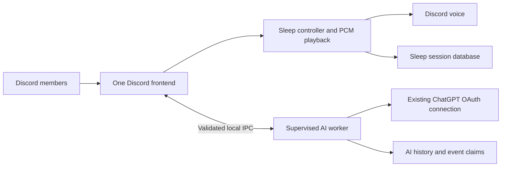

# Jarvis + Sleep Companion

A combined Discord application built from the existing Jarvis and DiscordSleepBot projects. The visible application is the existing **RainBot** identity. It hosts Jarvis text/image assistance and sleep ambience through one Discord connection. Jarvis inference, image conversion and DPAPI work run in a supervised child process.

## Start and stop

Rain and sunny ambience default to **20%** recording level. `RAIN_VOLUME=0.2` in `.env` controls both modes; restart the bot after changing it. Rain thunder scales with the same setting.

Requires Windows, Node.js `>=24.19.0 <25`, and local configuration through Settings or a private `.env`. Existing ChatGPT authorization and dashboard-saved credentials are protected with Windows CurrentUser DPAPI.

```powershell
cd E:\Projects\2026Projject\personalAIDiscordBot\combined-discord-companion
npm start
```

Keep the terminal open. Press Ctrl+C to stop both processes. If the background deployment is already running, a second start is intentionally rejected by the frontend lock. Use the existing process or stop its **verified** PID first. No automatic Windows startup/service is installed.

Do not start either original bot alongside the combined runtime. The original sleep project has no compatible ownership guard and would share the same Discord token; the original Jarvis would consume the same connected AI grant through a different credential copy.

Local operational status is written every 10 seconds to `data/runtime-status.json`: Discord readiness, AI state, active voice/player state, frontend memory, interval CPU and event-loop delay. The file does not contain member messages, tokens or account identities. It is a local snapshot, not a substitute for checking that its PID is still running. Startup output goes to `data/bot.stdout.log` and `data/bot.stderr.log` for the hidden deployment.

## Windows app

A dedicated RainBot Windows application is available, with its own window, system tray, Start/Stop, protected self-hosting settings, setup actions, and bundled runtime. Build output: `desktop/out/make/squirrel.windows/x64/RainBotSetup.exe`. The current installer is unsigned. See [Windows installation, import, build and recovery](WINDOWS_APP.md). Desktop state is separate under `%LOCALAPPDATA%\RainBot`; importing the source installation is explicit and requires it to be stopped first.

The browser dashboard below remains available for source-based development and recovery.

## Local web dashboard

Run `npm run dashboard`, then open [RainBot workspace](http://127.0.0.1:3210). Choose **Connect workspace** and enter the single-use local access code printed in the terminal. The code expires after 10 minutes; the browser session lasts 12 hours. Restarting the dashboard issues a new code and does not stop the bot. Keep the dashboard terminal open; Ctrl+C closes the dashboard.

The responsive Material Design-inspired interface includes Overview, Ambience, searchable Commands, System Health, and Settings, with light/dark themes. It refreshes operational status every 10 seconds and marks stale or stopped runtimes offline. No additional dependencies or frontend build are required.

**Start bot** launches this installation once. **Stop bot** requests cooperative shutdown of the verified frontend and its AI worker, preserving saved sleep sessions for the next start. The process state is separate from Discord/AI readiness. Closing the dashboard leaves the bot running; reopening it reconnects to its verified local control channel. Stop disconnects voice and interrupts active AI work. Controls never force-stop processes or silently delete bot/auth locks.

An older instance without the new control channel appears as **Externally managed**. Stop it through its existing terminal or the documented verified operational procedure, then start the updated bot once using `npm start` or the dashboard. Do not launch a second copy or remove a lock just because a snapshot is stale. If startup/shutdown cannot be verified, controls fail closed and show recovery guidance.

Settings cover Discord identity/token, AI provider/model, access restrictions, controller roles, and shared ambience volume. **Save changes** writes a new local revision and never restarts the bot; running instances show **Restart required** until you explicitly Stop and Start. Existing secrets appear only as Configured, with Replace/Remove actions. Newly entered credentials are cleared after saving or leaving Settings.

Ambience and other Discord actions still copy slash commands; the bot's Discord permissions remain authoritative. **Test saved connection** validates saved configuration without starting the bot or registering commands. In API-key mode it checks authentication/model catalog only, not inference. **Test AI response · may use API credit** is an explicit, bounded request; saving, loading pages, and catalog tests never perform paid inference.

The server binds only to `127.0.0.1`. Administrative routes require the local owner session, same-origin checks, CSRF protection, bounded requests, and rate limits. The read-only operational snapshot remains sanitized; raw credentials, conversation history, and logs are never served. This is a local owner interface, not remote hosting or isolation from other programs running as your Windows user. Set `DASHBOARD_PORT` in your terminal to use another port; it is not loaded from `.env` by the dashboard launcher.

### Self-hosting with your own bot and API key

The supported setup is **Windows, one installation per owner and configured AI server**. Each host supplies their own Discord application/token and AI connection. Individual Discord-member API keys, shared tenant accounts, other AI vendors, Linux, and Docker are not implemented.

1. Use Node.js `>=24.19.0 <25`, install this project's pinned dependencies, and retain its bundled `assets/` files. Copy source and example configuration only; never distribute another owner's `.env`, `data/`, credentials, or conversations.
2. Run `npm run dashboard`, connect the owner browser session, and open Settings. Supply your Discord bot token, matching application ID, server ID, and owner ID. Install that bot into your server with the documented chat/voice permissions; enable Message Content intent for selected-message reading.
3. Choose **OpenAI API key**, enter your own key and a Responses-compatible model available to your API project, and save. Reasoning and optional web search must be supported by that model; API web search is off by default. Model catalog access does not prove inference or tool compatibility. API usage belongs to your API project; it does not use this installation owner's existing ChatGPT grant.
4. Alternatively, retain **Existing ChatGPT connection**. With the bot stopped, run `npm run auth -- login` under your Windows account. The existing authorization flow and account eligibility rules remain unchanged.
5. Run `npm run register` explicitly once configuration is saved. It reads the same effective settings, upserts the six commands, and preserves unrelated commands. Saving or starting never registers commands automatically.
6. Click Start bot. Verify Discord/AI readiness and use the existing Discord pilot checks before relying on unattended playback.

API requests follow OpenAI's [server-side authentication guidance](https://developers.openai.com/api/reference/overview#authentication) and [Responses-based text generation](https://developers.openai.com/api/docs/guides/text). Credentials never go in frontend bundles or browser storage, and provider failures never trigger automatic switching between API billing and the existing ChatGPT connection.

### Configuration storage and recovery

Startup, registration, and auth now share one configuration bootstrap. Precedence is **explicit inherited deployment environment → saved dashboard settings → legacy `.env` → defaults**. Existing `.env` files are not automatically rewritten or migrated. Externally overridden fields are disabled in Settings. Relative configured data/asset paths resolve against this installation.

`data/dashboard/settings.json` contains non-secret values and references a versioned `secrets-<revision>.dpapi` file protected by Windows CurrentUser DPAPI. Saving commits the encrypted file before atomically replacing the settings manifest, and retains `settings.previous.json` plus its encrypted credential reference. The existing `data/ai/chatgpt.dpapi` grant remains separate. Moving installations to another Windows user/machine requires entering credentials again. Explicit Remove overrides a legacy secret instead of silently restoring it from `.env`.

On settings corruption, stop any verified bot first and restore a consistent `settings.previous.json` with its referenced encrypted file under the same Windows account. A leftover `settings.lock` or `supervisor.lock` requires confirming that its owner is no longer active before recovery. Never remove frontend/AI locks based only on sandboxed visibility. The supervisor records launched PIDs even before startup completes, so a timed-out launch cannot be blindly duplicated. Inspect the existing process and local `data/bot.stdout.log` / `data/bot.stderr.log` before retrying.

## Discord usage

| Action | Command |
| --- | --- |
| Ask Jarvis | `/ask prompt:...` or mention RainBot with a question |
| Private AI answer | `/ask prompt:... private:true` |
| Attach a screenshot | `/ask image:...` with an optional prompt, or tag RainBot in a message with one attachment |
| Explain a selected message | Reply to that message, mention RainBot and say what to explain |
| Clear your AI context in this channel | `/reset` |
| Change a member’s server nickname | `/nickname member:@Ali name:Raja Tidur` |
| Check AI connection | `/status` |
| Join your voice channel | `/sleep join mode:rain`, `sunny` or `silent` |
| Change ambience | `/sleep rain on`, `/sleep sunny on` |
| Quietly remain in voice | `/sleep rain off` or `/sleep sunny off` |
| Choose a rain scene | `/sleep rain style scene:...` or `/sleep rain mild-thunder` |
| Check voice/audio | `/sleep status` |
| Leave and disable automatic restoration | `/sleep leave` |

AI replies are typed, including in voice-channel text chat. There is no microphone listening, voice transcription or AI speech. Public AI delivery is one message containing question, answer and, for own uploads, image preview. Long text uses one `response.txt` attachment. Ambience on/off deliberately keeps the sleep bot’s private acknowledgment plus one public announcement.

### Nickname changes

Only the configured owner (`OWNER_DISCORD_ID`) and members with **Manage Nicknames** may request changes, within the configured AI guild/channel/role access rules. These change a **server nickname**, not a global Discord account username.

Use `/nickname member:@Ali name:Raja Tidur` for a private acknowledgment, or ask through `/ask`/a direct bot mention:

```text
@RainBot tolong tukar nickname @Ali jadi "Raja Tidur"
@JarvisAI bah bolehkan kalau kau tukar nama @Ali kepada Raja Tidur
@RainBot rename @Ali to "Raja Tidur"
```

Select real Discord mentions for your bot and the target member. Chat requests need one explicitly mentioned target and one exact nickname after `to`, `kepada` or `jadi`; quotes are optional. Sabahan courtesy openings such as `bah bolehkan kalau kau` are supported. Jarvis cannot pick a different member/name, rename someone from quoted context or previous history, or act on a hypothetical/negative request. For other phrasing, use `/nickname`. Names must contain 1–32 characters without control characters or line breaks.

RainBot needs **Manage Nicknames**, and its highest role must be above the target’s highest role, following [Discord’s permission hierarchy](https://docs.discord.com/developers/topics/permissions#permission-hierarchy). The server owner cannot be renamed by a bot. Other moderators must also outrank their target, except when changing their own nickname; the configured bot owner is explicitly authorized but still subject to the bot’s Discord hierarchy limits. Current actor/bot permissions, member roles and configured access restrictions are fetched again immediately before an action.

Chat requests provide one exact function capability to the worker. A completed AI function call is validated against it, then the frontend performs only a nickname PATCH and returns a confirmed application result. No model-written “done” message triggers a change. Duplicate worker calls share the same action promise; durable frontend event claims prevent replayed actions after restart. Slash nickname changes do not require AI availability. A four-request action queue and two-second per-member cooldown bound direct action load.

The result is acknowledged only after Discord confirms the requested nickname. Successful changes show the requester, target member and new nickname publicly in the requesting channel. Public AI/mention replies carry this confirmation themselves; `/nickname` and private `/ask` also post one public confirmation after completing their private acknowledgment. Mentions are displayed without pinging members. Failed, replayed and already-set requests do not post an announcement. If posting fails after the rename succeeds, the private result explains that the name changed but its announcement could not be posted. An interrupted/failed request can have an uncertain result; check the member’s current nickname before sending a new request. Discord’s audit reason records the requesting member and source event. An AI private answer does not make the resulting server nickname private.

RainBot needs View Channel, Send Messages, Read Message History, Attach Files and Embed Links for the full chat experience; Connect and Speak for ambience. Enable **Message Content Intent on RainBot’s Bot page** in Discord Developer Portal to read selected ordinary messages through REST. The gateway deliberately subscribes only to Guilds, GuildMessages and GuildVoiceStates; bot mentions arrive through Discord’s mention exception. No channel-history sweep or voice recording is performed.

## Access, personality and context

AI settings preserve server access, configured AI guild/channel/role restrictions, **gpt-6-luna / reasoning high**, context-first optional web search and the existing sarcastic Sabah personality. Edit this project’s `PERSONALITY.md`; changes are read on the next request. Editing the original project’s personality does not update this copy.

Only the server owner, members with Administrator/Manage Server, or `CONTROLLER_ROLE_IDS` can change sleep sessions. Ordinary members may use permitted AI commands and view sleep status. AI output cannot execute voice controls: members use the deterministic `/sleep` commands themselves.

History is isolated by guild, channel, requesting member and public/private visibility. Context includes that member’s earlier Jarvis questions/answers and an explicitly selected same-channel reply chain; it does not ingest their ordinary channel messages. A direct attachment takes priority over a referenced image. Another member’s referenced image is analyzed but is not reposted. Image bytes and download URLs are not retained in history. Public output and supplied context are sent to the existing connected AI account; everyone shares its allowance.

Web search is optional: Jarvis uses supplied text, images, references and history first, then searches when missing public facts are needed. Having context does not prohibit searching; having no context does not force it. The existing OAuth subscription adapter is preserved, with no paid API-key fallback.

## Architecture and failure behavior



`src/main.ts` owns all Discord events and sends each known slash command to one handler. `src/integration/sleep-handler.ts` acknowledges controls before fetching the member and enforces sleep permissions. The preserved `src/sleep/` modules implement per-guild serialized actions, reconnects, removal suspension, one voice channel per guild, rain scenes/thunder and sunny loops. Assets are local PCM; attribution is in `assets/SOURCE.md`.

The worker receives bounded AI requests and selected context through advanced Node IPC serialization. Its environment excludes Discord credentials, API keys and inherited Node injection options. This is process isolation for responsiveness and accidental failure containment, **not an OS security sandbox**: both processes run as the same Windows user.

The frontend formats no AI images. Worker output contains the final Discord payload, including binary attachments. The frontend delivers it once and acknowledges delivery; the worker commits history only afterward. Repeated/late results cannot send a second callback. Durable SQLite event claims prevent regeneration on Discord event replay; mention sends additionally enforce a source-message nonce. Delivery is not a distributed transaction: a crash after Discord accepts a message can lose its history turn, but the event is not automatically replayed.

Worker crashes reject outstanding questions and trigger bounded backoff restarts without resetting voice/player objects. Only a lock owned by the exact exited worker is cleared automatically. Auth/foreign locks are never cleared. Failed/crashed questions must be sent again as a **new** Discord message/interaction. The frontend can continue sleep controls while AI is starting, unavailable or usage-limited. A frontend or host crash still interrupts voice until restart; the child does not make voice independently resilient to a host outage.

AI limits remain: one active generation, four active/queued conversations, five-second per-member cooldown, two-minute active request deadline, 4,000-character prompt, 12,000-character output, one image up to 14 MiB and bounded raster decoding. Local conversations expire after 24 hours and retain at most ten whole turns/24,000 characters. Image previews are capped at 8 MiB and respect the upload limit supplied for slash interactions. IPC adds bounded reference/delivery waits and a total queue/request watchdog.

## Storage and ownership

| Location | Purpose |
| --- | --- |
| `.env` | Sleep bot token/identity, AI restrictions/model, controller/audio settings |
| `data/dashboard/settings.json`, `settings.previous.json` | Current and previous managed settings manifests; no plaintext secrets |
| `data/dashboard/secrets-<revision>.dpapi` | Versioned encrypted Discord/API credentials referenced by a settings manifest |
| `data/dashboard/control.dpapi`, `runtime.json`, `supervisor.json` | Protected local-control credential and verified runtime/launch identities |
| `data/frontend/<application-id>/runtime.lock` | Exclusive Discord frontend owner |
| `data/frontend/<application-id>/nickname-events.sqlite` | Durable nickname action event claims; reset does not erase them |
| `data/ai/runtime.lock` | AI worker or auth command owner |
| `data/ai/chatgpt.dpapi`, `host-id` | Existing encrypted authorization and host binding |
| `data/ai/conversations.sqlite` | Scoped text history and durable event claims |
| `data/sleep/sessions.sqlite` | Voice session/channel/mode/style/persistence |
| `data/backups/` | Command manifests and consistent pre-cutover database/credential snapshots |

The `.env`, data, logs and node_modules are ignored. History databases are unencrypted local files; DPAPI protects credentials only. Preserve this Windows account and protect local access. Never publish `.env`, data or a whole runtime folder.

Before deleting a stale lock, inspect **unrestricted** Windows processes and their working directories. Sandboxed inspection previously missed active bots and led to duplicate handlers. `scripts/process-directory.ps1 -ProcessIds <pid>` reads only the directory metadata of an identified 64-bit process; it does not print environment variables. Verify the PID and exact project/entry point again before stopping it.

## Maintenance and verification

```powershell
npm run check
npm test
npm run register
```

Registration upserts these six commands in the configured AI guild individually; it preserves unrelated commands and existing global scopes. Do not run the original projects’ bulk command registrars against the combined application.

Stop the combined runtime before `npm run auth -- status`, `models`, `login`, `test` or `logout`. These share the AI lock. Reauthorization is necessary only if the current grant cannot refresh. A live auth test consumes the connected plan allowance; normal tests use fixtures/stubs and do not contact Discord or perform live inference.

The migration utility uses SQLite’s backup API, verifies `PRAGMA quick_check`, preserves sources, and refuses to overwrite targets. `scripts/state-transfer.ts --rehearsal` exercises copies. Actual migration requires both original runtimes to be verified stopped and `--originals-stopped`; the source AI lock must already be absent. This utility does not stop processes or delete locks.

See `PROJECT_STATE.md` for the deployment snapshot, test count, current caveats and pilot checklist. Automated audio tests verify frames/loops and controller/state behavior. Human listening while overlapping text/image requests remains necessary before relying on unattended overnight playback.

## Rollback

1. Verify and stop the combined frontend and worker. Confirm both PIDs are gone before touching locks. Preserve a consistent backup of the **current** combined databases and encrypted credential blob first.
2. Copy the newest `data/ai/chatgpt.dpapi` and `host-id` back to the original Jarvis `data/` under the same Windows account. OAuth refresh rotation may make the pre-cutover original credential stale. Do not decrypt or paste it. To retain post-cutover chats/sleep changes, use a consistent SQLite backup to the original state paths while all consumers are stopped; otherwise explicitly choose the pre-cutover snapshots and accept losing newer state.
3. Restore the recorded pre-cutover guild commands. The exact snapshot path is recorded as `preCutoverCommandBackup` in `data/deployment.json`. Preview with `node --env-file=.env --import tsx scripts/restore-commands.ts <snapshot-path>`, then add `--apply` during rollback. It upserts saved definitions and removes only the newly added AI command names absent from that snapshot, preserving unrelated commands/global scopes. The original Jarvis application’s commands were never modified.
4. Start one original sleep instance from `E:\Projects\2026Projject\DiscordSleepBot` and one original Jarvis from its original folder. Verify their working directories, Discord identities and ownership. Do not start the combined runtime alongside them.

Neither original project’s application code is modified by this integration. Runtime snapshots and encrypted copied grants are private and should not be redistributed.
